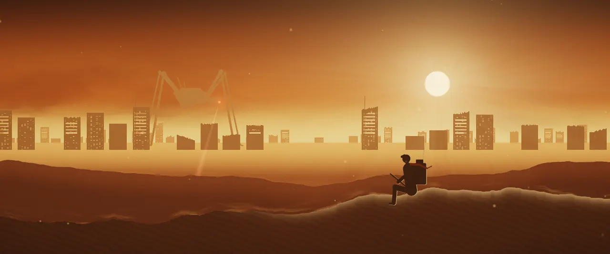
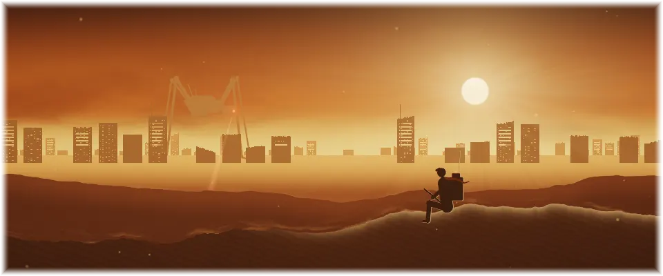

# Topside

An animated theme for [Omarchy](https://omarchy.org). A giant walker paces past a ruined city in the dust, its searchlight sweeping, while a raider watches from a dune.

> **Animated with [omarchy-live-wallpaper](https://github.com/Gleasonmt/omarchy-live-wallpaper).**
> Install that plugin too (below) to make the wallpaper move and to get the
> **Topside Lite** version. Without it the theme still works, with a still wallpaper.



## Install

Theme and plugin together:

```bash
omarchy theme install https://github.com/Gleasonmt/omarchy-topside-theme && omarchy plugin add https://github.com/Gleasonmt/omarchy-live-wallpaper --enable --yes
```

or one at a time:

```bash
omarchy theme install https://github.com/Gleasonmt/omarchy-topside-theme
omarchy plugin add https://github.com/Gleasonmt/omarchy-live-wallpaper --enable
```

Then pick **Topside** in Omarchy menu → Style → Theme. The first line is the theme
(colors, wallpaper, icons, keyboard lighting); the second makes the wallpaper move,
and also adds **Topside Lite** to the picker: the same picture with only small
parts moving, which uses the least power. Without the plugin you get the theme
with a still wallpaper.

Update with `omarchy theme update` and `omarchy plugin update`.

## Topside Lite

The same scene, still, with only its small details alive. It uses the least power,
which makes it good for battery or a calmer desktop:



## How it moves

The wallpaper is a GPU shader (`live/1-topside.frag.qsb`, source in `src/`) drawn by the
[live-wallpaper plugin](https://github.com/Gleasonmt/omarchy-live-wallpaper);
`backgrounds/1-topside.png` is a frame of it, used by the lock screen and when the plugin
isn't installed. It pauses while a window covers the screen. See the plugin's README
for frame rates and battery settings.

Original artwork. The look is inspired by films and games; no logos or characters
are used.

## License

[MIT](LICENSE)
